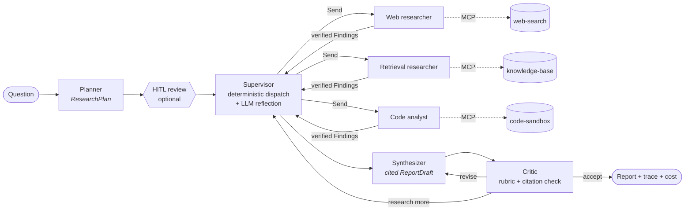

# Agentic Research Assistant — Multi-Agent (LangGraph + MCP)

> © 2026 Tanmay Roy · **Proprietary, view-only** — not open source. See [LICENSE](LICENSE).

A reference implementation of **supervisor / sub-agent orchestration** for deep research:
tool-calling specialists (web search, knowledge-base retrieval, sandboxed code execution) served over
**Model Context Protocol** servers, **structured output** at every hop, a bounded **self-critique** loop, and an
**LLM-as-judge** evaluation loop that gates releases. **Amazon Bedrock first**, provider-agnostic.

> Runs fully offline (no API keys) with a deterministic fake model against the real MCP servers — the same code
> path as production, so CI exercises the whole system for free.



## Highlights

| Area | What's implemented |
|---|---|
| **Orchestration** | LangGraph `StateGraph`; planner → hybrid supervisor → parallel workers via `Send` (map-reduce) → synthesizer → critic loop; HITL plan approval with `interrupt`/`Command`; checkpointing; custom streaming events |
| **Sub-agents** | Bounded ReAct loops (step + tool-call budgets), structured extraction, **grounding verification** of every evidence locator, prompt-injection **quarantine** |
| **Tools over MCP** | 3 FastMCP servers (stdio for dev, **stateless Streamable HTTP** in containers); per-agent least-privilege binding; SSRF guard; hybrid BM25 + dense retrieval with RRF; layered Python sandbox |
| **Structured output** | Pydantic contracts for plan, routing, findings, report, critique, judge; validation retries; system-only fields filled by code |
| **Quality** | Runtime self-critique (weighted rubric + deterministic citation check); offline LLM-as-judge (rubric + pairwise with position swap); judge calibration (weighted κ, Spearman); CI gates incl. regression vs baseline; sampled online judging |
| **Governance** | Cost cap per request with graceful partial answers, recursion limits, input validation, checkpoint deserialisation allow-list, API key auth |
| **Ops** | FastAPI + SSE, Typer CLI, per-run token/cost tracking by model, JSON logs, LangSmith/OTel-ready, Docker + compose (sandbox on internal-only network), GitHub Actions (lint, types, tests, eval smoke, image build, nightly Bedrock eval via OIDC) |
| **Docs** | [Solution architecture](docs/architecture.md) · [7 ADRs](docs/adr/) · [Evaluation strategy](docs/evaluation.md) · [Interview guide](docs/interview-guide.md) |

## Quickstart

### 1. Offline (no keys, ~2 minutes)

```bash
python -m venv .venv && source .venv/bin/activate
pip install -e ".[dev]"
cp .env.example .env

LLM_PROVIDER=fake ara run "What caused the March 2026 agent runaway incident and which controls prevent a repeat?"
pytest                      # 49 tests: graph e2e with real MCP servers, sandbox, SSRF, HITL, API, eval
```

### 2. Amazon Bedrock

```bash
# .env
LLM_PROVIDER=bedrock
AWS_REGION=us-west-2                     # AWS_PROFILE or env credentials / instance role
MODEL_REASONING=global.anthropic.claude-sonnet-4-6
MODEL_FAST=global.anthropic.claude-haiku-4-5-20251001-v1:0
JUDGE_MODEL=global.anthropic.claude-opus-4-6-v1
WEB_SEARCH_PROVIDER=tavily               # or ddg (pip install -e ".[ddg]")
TAVILY_API_KEY=tvly-...
RETRIEVAL_EMBEDDINGS=bedrock             # Titan Text Embeddings v2 (or keep "hash")

ara run "Which data-residency rules apply to APAC Bedrock workloads and what is the price trade-off?"
```

Enable model access for the Anthropic models in the Bedrock console first. For data residency use `apac.` /
`eu.` / `us.` inference-profile prefixes instead of `global.` (≈10% premium; availability varies by model).
Other providers: `LLM_PROVIDER=anthropic | openai | azure_openai` (install `.[anthropic]` / `.[openai]`).

### 3. Containers (API + three MCP services)

```bash
cp .env.example .env        # set provider credentials
docker compose up --build
curl -N -X POST localhost:8000/v1/research/stream \
  -H 'content-type: application/json' \
  -d '{"question":"What transports does MCP support and why run tool servers statelessly?"}'
```

## Usage

```bash
ara run "<question>" [--no-stream] [--out report.md] [--trace]
ara eval [--limit N] [--baseline reports/baseline.json]   # exits 1 if quality gates fail
ara calibrate labels.jsonl                                # judge vs human agreement
ara serve                                                 # FastAPI on :8000
ara graph                                                 # Mermaid of the LangGraph topology
```

### API

| Method & path | Purpose |
|---|---|
| `POST /v1/research` | Run to completion (or pause for plan approval). Returns report, markdown, trace, usage |
| `POST /v1/research/stream` | **SSE**: `plan`, `dispatch`, `worker_start`, `tool_call`, `injection_suspected`, `worker_done`, `supervisor_decision`, `draft`, `critique`, `final`, `result` |
| `POST /v1/research/{thread_id}/resume` | HITL: `{"approved": true}` / `{"approved": false, "feedback": "..."}` / `{"plan": {...}}` |
| `GET /v1/research/{thread_id}` | Checkpointed state summary |
| `GET /healthz`, `GET /readyz` | Liveness; readiness verifies all MCP tools are loaded |

Example response excerpt:

```json
{
  "status": "completed",
  "usage": {"llm_calls": 20, "input_tokens": 16471, "output_tokens": 2862, "est_cost_usd": 0.0,
            "tool_calls": {"web_search": 1, "fetch_url": 1, "search_documents": 2, "run_python": 1}},
  "trace": {
    "findings": [{"task_id": "t1", "agent": "web_researcher", "evidence": 3, "verified": 3, "latency_s": 0.05}],
    "critiques": [{"revision": 0, "score": 0.65, "verdict": "revise"},
                  {"revision": 1, "score": 0.95, "verdict": "accept"}]
  }
}
```

## Project layout

```
src/research_assistant/
├── graph.py              # topology: nodes, edges, Send fan-out, loops, checkpointer
├── state.py              # typed state + reducers for parallel writes
├── schemas.py            # Pydantic contracts (LLM-facing vs system records)
├── agents/
│   ├── planner.py        # ResearchPlan + HITL interrupt
│   ├── supervisor.py     # deterministic dispatch + LLM reflection
│   ├── workers.py        # bounded ReAct subgraphs, extraction, verification, quarantine
│   ├── writer.py         # synthesizer, critic (evaluator-optimizer), finalize
│   └── common.py         # RunContext, source registry, formatting, events
├── mcp_servers/          # FastMCP: web_search_server, retrieval_server, code_exec_server
├── tools/mcp_client.py   # MCP sessions + least-privilege tool binding
├── llm.py · llm_fake.py  # provider factory (Bedrock first) + deterministic offline model
├── guardrails.py         # injection, SSRF, grounding, citations, input validation
├── observability.py      # usage/cost tracking, logging
├── prompts.py            # versioned prompts
├── eval/                 # judge.py, run_eval.py, calibration.py, datasets/
├── service.py            # run / stream / resume
├── api/app.py · cli.py · studio.py (LangGraph Studio factory)
data/corpus/              # sample internal knowledge base (fictional "Acme" documents)
data/fixtures/            # offline web corpus (paraphrased public sources + one malicious page)
docs/                     # architecture, ADRs, evaluation, interview guide
```

## Configuration (selected)

| Variable | Default | Purpose |
|---|---|---|
| `LLM_PROVIDER` | `bedrock` | `bedrock` · `anthropic` · `openai` · `azure_openai` · `fake` |
| `MODEL_REASONING` / `MODEL_FAST` / `JUDGE_MODEL` | Sonnet 4.6 / Haiku 4.5 / Opus 4.6 | Role-based model tiering |
| `MCP_TRANSPORT` | `stdio` | `streamable_http` for containers |
| `WEB_SEARCH_PROVIDER` | `offline` | `tavily` · `ddg` · `offline` |
| `MAX_PARALLEL_WORKERS` / `MAX_RESEARCH_ROUNDS` / `MAX_REVISIONS` | 4 / 2 / 2 | Fan-out and loop bounds |
| `MAX_TOOL_CALLS_PER_WORKER` / `MAX_WORKER_STEPS` | 6 / 6 | Per-agent budgets |
| `MAX_COST_USD` | 0.50 | Per-request cost cap → partial answer, never a runaway |
| `CRITIC_PASS_THRESHOLD` | 0.75 | Weighted rubric score to accept a draft |
| `REQUIRE_PLAN_APPROVAL` | false | Human-in-the-loop plan review |
| `EVAL_MIN_OVERALL` | 3.5 | CI gate on mean judge score (1-5) |
| `ONLINE_EVAL_SAMPLE_RATE` | 0.0 | Fraction of API traffic judged asynchronously |

See `.env.example` for the full list.

## Evaluation

```bash
ara eval                                  # Bedrock: system under test + Opus judge
LLM_PROVIDER=fake EVAL_MIN_OVERALL=2.5 ara eval   # plumbing smoke, zero cost
```

Produces `reports/latest.{json,md}` with per-criterion judge scores, key-point recall, citation validity, cost
and latency percentiles, gate results and judge reasoning per item. Details in
[docs/evaluation.md](docs/evaluation.md).

## Notes and limitations

* The bundled knowledge base documents are **fictional** samples; the offline web corpus contains **paraphrased
  summaries** of real public sources (see `data/fixtures/README.md`). `calibration_sample.jsonl` is synthetic.
* The fake model validates plumbing, not answer quality — quality claims require a Bedrock (or other provider)
  eval run.
* Prices in `observability.py` and the docs are indicative list prices (Oct 2026); verify for your region.
* Demo-grade components with production upgrade paths: in-memory retrieval index and checkpointer, subprocess
  sandbox. See [architecture §16](docs/architecture.md#16-known-limitations-and-roadmap).

## License

**Proprietary — view only. © 2026 Tanmay Roy. All rights reserved.**

This repository is public for reference and portfolio review only. You may read it and discuss the ideas with
attribution, but you may **not copy, modify, redistribute, reuse it in your own projects, present it as your own
work, or use it to train AI models**. See [LICENSE](LICENSE) for the full terms. For any other use, ask first.
