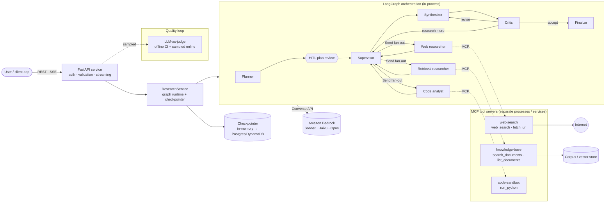
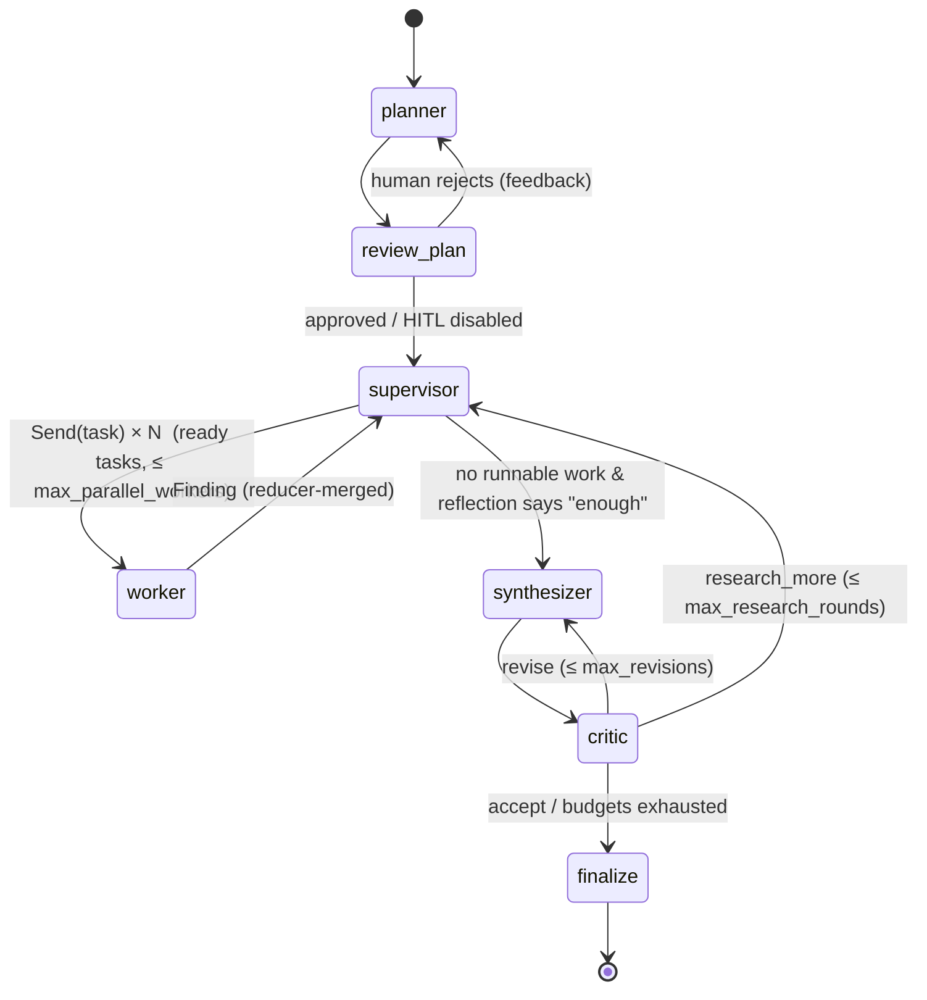
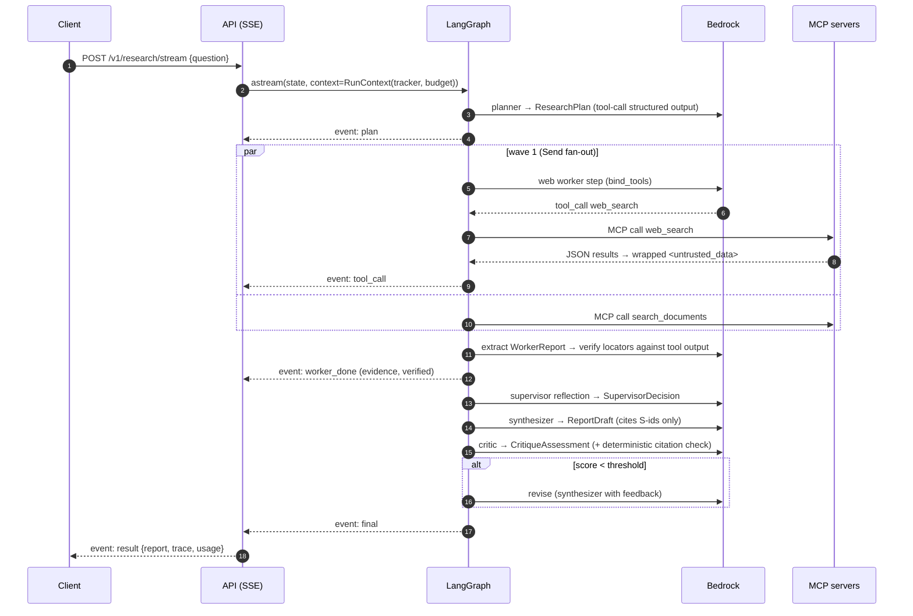
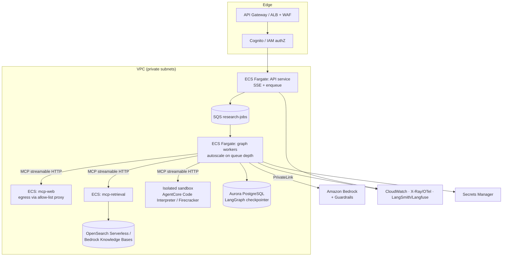

# Solution Architecture — Agentic Research Assistant

> Reference architecture for a **supervisor / sub-agent** research system: tool-calling specialists over
> **MCP**, **structured output** at every hop, a bounded **self-critique** loop, and an **LLM-as-judge**
> evaluation loop that gates releases. Bedrock-first, provider-agnostic.

| | |
|---|---|
| **Status** | Reference implementation (v0.1) |
| **Audience** | Solution / enterprise architects, AI platform teams, reviewers in an architecture board |
| **Related** | [ADRs](adr/) · [Evaluation strategy](evaluation.md) · [Interview guide](interview-guide.md) |

---

## 1. Problem, goals and non-goals

**Problem.** Knowledge workers spend hours answering questions that need *several kinds of evidence at once*:
public sources (vendor docs, papers, news), internal documents (policies, post-mortems, standards) and a bit of
arithmetic to reconcile numbers. A single chat completion hallucinates citations; a single ReAct agent
serialises everything, blows its context window and is hard to govern.

**Goals**

| # | Goal | How it is met |
|---|------|---------------|
| G1 | Decision-grade answers with **verifiable citations** | Evidence must quote a locator that appears in tool output; report cites only registry IDs |
| G2 | **Parallel** research across heterogeneous sources | Planner decomposes → supervisor fans out with LangGraph `Send` |
| G3 | **Governable**: bounded cost, steps, permissions | Budgets in code, per-agent tool scoping, sandbox, cost cap with graceful degradation |
| G4 | **Measurable quality** that gates releases | Offline LLM-as-judge + deterministic metrics in CI; sampled online judging |
| G5 | **Portable** across model providers and hosting | `BaseChatModel` abstraction, config-only provider switch, MCP tool boundary |
| G6 | **Operable**: observable, testable without keys | Usage/cost tracking, streaming events, deterministic fake LLM for CI |

**Non-goals (v0.1):** autonomous write actions (sending email, editing systems), multi-tenant isolation of the
knowledge base, long-term user memory, UI. These are discussed under *Roadmap*.

---

## 2. Architecture at a glance

Three layers with hard boundaries:

1. **Orchestration** (LangGraph, in-process) — owns control flow, state, budgets and quality loops.
2. **Capabilities** (MCP servers, out-of-process) — own side effects: network, data access, code execution.
   Each has its own process, dependencies, network policy and (in AWS) IAM role.
3. **Models** (Bedrock by default) — stateless reasoning engines, selected per role (tiering).

---

## 3. Orchestration topology

| Node | Model tier | Responsibility | Output contract |
|------|-----------|----------------|-----------------|
| `planner` | reasoning | Decompose question into 2-5 typed sub-tasks with dependencies + success criteria | `ResearchPlan` |
| `review_plan` | — | Optional `interrupt()` for human approval / edit / reject-with-feedback | resume payload |
| `supervisor` | reasoning (only for reflection) | **Deterministic** dependency-aware dispatch; **LLM** gap analysis when a wave completes | `SupervisorDecision` |
| `worker` ×N | fast | Bounded ReAct loop over *its own* MCP tools → structured extraction → grounding verification | `WorkerReport` → `Finding` |
| `synthesizer` | reasoning | Write cited report from condensed findings + numbered source registry | `ReportDraft` → `ResearchReport` |
| `critic` | reasoning | Rubric self-critique + deterministic citation check → accept / revise / research_more | `CritiqueAssessment` → `CritiqueRecord` |
| `finalize` | — | Attach limitations (failed tasks, budget stop, quality bar not met) | `ResearchReport` |

**Patterns combined** (Anthropic's taxonomy): *plan-and-execute* + *orchestrator-workers* (supervisor +
map-reduce) + *evaluator-optimizer* (critic loop) + *human-in-the-loop*. Each loop is explicitly bounded.

### Why a *hybrid* supervisor?

A purely LLM-routed supervisor ("which agent next?") spends a reasoning-tier call on every hop and is
non-deterministic in exactly the place you want predictability. Here:

* **Code decides** what is runnable (dependencies satisfied), how wide to fan out, when budgets stop work and
  how to break dependency cycles. Zero tokens, unit-testable (`tests/test_schemas_and_supervisor.py`).
* **The LLM decides** only the judgement call: *"given these findings and the success criteria, is anything
  material missing, and what exact follow-up tasks would close it?"* — plus gaps the critic raises.

---

## 4. Request lifecycle (sequence)

---

## 5. State and context engineering

The state (`state.py`) is a typed, checkpointable `TypedDict` with **reducers** for every field written by
parallel branches (`findings: operator.add`, `task_status: merge_dicts`, `usage: sum`). Single-writer
fields (`tasks`, `plan`, `draft`) are plain overwrite. Non-serialisable run context (usage tracker, cost
budget, caller identity) travels in LangGraph's **`context_schema`** (`RunContext`), never in state.

**Context isolation is the core design choice.** A worker's transcript (tool calls, raw pages, retries) lives
only inside its subgraph. What crosses back to the parent is a compact `Finding`: summary + atomic evidence
items + confidence + verification flags. Consequences:

* The synthesizer's prompt scales with *number of findings*, not with *volume of raw web text* — avoiding the
  "lost in the middle" degradation and keeping reasoning-tier tokens (the expensive ones) small.
* Workers can run on a cheaper model because each sees only its own narrow task.
* Each sub-agent can be evaluated and replaced independently.

Additional context hygiene: tool outputs are truncated to `TOOL_OUTPUT_CHAR_LIMIT`; dependency context passed to
a worker is only the *summaries* of the tasks it depends on; the supervisor sees findings, not transcripts.

---

## 6. Tool layer — Model Context Protocol

| Server | Tools | Side effects | Network | Production backend |
|--------|-------|--------------|---------|--------------------|
| `web-search` | `web_search`, `fetch_url` | Outbound HTTP | Internet egress (allow-list in prod) | Tavily / Brave / Bing API; fixture corpus offline |
| `knowledge-base` | `search_documents`, `list_documents` | Read-only data access | Only to embeddings / vector store | OpenSearch Serverless, Bedrock Knowledge Bases, pgvector |
| `code-sandbox` | `run_python` | Executes untrusted code | **None** (internal network only) | Bedrock AgentCore Code Interpreter, Firecracker/gVisor sandbox |

**Why MCP instead of in-process `@tool` functions?**

1. **Blast-radius isolation** — the code sandbox can crash, hang or be attacked without touching the
   orchestrator; it runs with no credentials and no egress.
2. **Least privilege, structurally** — `AGENT_SERVERS` binds each specialist only to its server's tools. A
   prompt-injected page read by the web agent cannot trigger code execution because that capability is *not
   bound* to that agent (`tests/test_graph_e2e.py::test_least_privilege_tool_scoping`).
3. **Independent lifecycle** — tool servers scale, deploy and are owned separately (often by different teams);
   the same servers serve other MCP clients (IDEs, desktop assistants, other agents).
4. **Stable contract** — swapping BM25 for OpenSearch or the subprocess sandbox for AgentCore changes nothing
   in the agent code.

**Transports.** `stdio` for local dev/tests (servers spawned as subprocesses, sessions kept open by
`MCPToolRegistry` to avoid per-call process start-up); **stateless Streamable HTTP** for containers so replicas
sit behind a plain load balancer without sticky sessions (`docker-compose.yml`).

**Tool-call execution** is hand-built (not a prebuilt `ToolNode`) to get the hooks governance needs: per-worker
tool-call budget, per-call timeout, structured error objects (the root cause of the reference incident was an
error *string* the model read as an instruction), `<untrusted_data>` wrapping, injection scanning, and capture of
raw outputs for grounding verification.

---

## 7. Structured output strategy

* Every LLM hop that drives code returns a **Pydantic model** via `with_structured_output` (tool-calling under
  the hood → portable across Bedrock Converse, Anthropic, OpenAI and Azure OpenAI).
* Field descriptions *are* the prompt — schemas are small, explicit and ordered **reason → score** where
  scoring is involved (better calibration).
* Validation failures are retried (`structured(...).with_retry`), then node-level `RetryPolicy` handles
  transient provider errors; schema validators repair what code can repair safely (e.g. drop unknown
  `depends_on` ids, dedupe ids) and reject what it cannot.
* **LLM-facing schemas ≠ system records.** The model never fills fields it cannot be trusted with —
  verification flags, source IDs, timings and weighted scores are added by code (`Finding`, `Source`,
  `CritiqueRecord`, `ResearchReport`).

---

## 8. Quality loops: self-critique vs LLM-as-judge

| | Self-critique (runtime) | LLM-as-judge (evaluation) |
|---|---|---|
| Purpose | Improve *this* answer before returning it | Measure the *system* across a dataset; gate releases |
| When | Every request, inside the graph | CI (offline), nightly (Bedrock), sampled production traffic |
| Inputs | Draft + findings + success criteria | Final answer + **reference answer + key points** |
| Model | Reasoning tier (same family) | **Separate, stronger or different-family** judge |
| Output | `accept / revise / research_more` | Scores, pass rates, regressions, gate result |
| Deterministic companion | Citation check (unknown IDs, coverage ≥ 80%) | Key-point recall, citation validity, cost, latency |

The critic's verdict combines a weighted rubric (coverage 0.4, groundedness 0.4, coherence 0.2, mapped to 0-1)
with the deterministic citation check; *missing information* routes back to the supervisor for targeted
research rather than asking the writer to invent facts. Both loops are bounded (`MAX_REVISIONS`,
`MAX_RESEARCH_ROUNDS`) and a run always terminates with an answer plus explicit limitations.

See [evaluation.md](evaluation.md) for judge design, bias controls and calibration.

---

## 9. Security and threat model

| Threat (OWASP LLM Top 10 2025) | Vector here | Control | Where |
|---|---|---|---|
| **LLM01 Prompt injection (indirect)** | Web pages, documents | `<untrusted_data>` delimiting + system notice; injection tripwire; **evidence quarantine** (flagged evidence never reaches the writer); least-privilege tool binding | `guardrails.py`, `workers.py` |
| **LLM06 Excessive agency** | Agent calls powerful tools | Per-agent tool scoping; read-only tools only; HITL plan approval; no write actions in scope | `tools/mcp_client.py`, `planner.py` |
| **LLM10 Unbounded consumption** | Loops, fan-out, long pages | Step/tool/round/revision caps, `recursion_limit`, per-request **cost cap** with partial answer, output truncation | `config.py`, `supervisor.py`, `writer.py` |
| **LLM09 Misinformation** | Fabricated citations | Locator must literally appear in tool output; citations restricted to registry IDs; critic + judge groundedness | `guardrails.verify_evidence`, `check_citations` |
| **LLM05 Improper output handling** | Model output executed as code | AST policy + subprocess isolation + rlimits + no network/credentials | `code_exec_server.py`, `docker-compose.yml` |
| **SSRF** | `fetch_url` to metadata endpoints / internal IPs | Scheme allow-list, DNS-resolved IP must be global, re-check after redirects, size/timeout caps | `guardrails.assert_public_url` |
| **LLM02 Sensitive info disclosure** | Secrets leaking to tools | Explicit per-server env (code server gets no cloud creds), no secrets in prompts, API key auth | `mcp_client._server_env`, `api/app.py` |
| **LLM03 Supply chain** | Tampered checkpoints / deps | Checkpoint deserialisation allow-list; pinned deps; single container image | `graph.CHECKPOINT_TYPES`, `Dockerfile` |

Production additions: Amazon Bedrock Guardrails (prompt-attack filter, PII redaction, denied topics) on model
calls; WAF + Cognito/IAM authorisation at the edge; VPC endpoints (PrivateLink) for Bedrock; egress allow-list
proxy for the web server; Bedrock model-invocation logging to an encrypted bucket with retention.

---

## 10. Reliability and failure modes

| Failure | Detection | Behaviour |
|---|---|---|
| Bedrock throttling / 5xx | botocore adaptive retries; node `RetryPolicy` | Backoff and retry; then node error surfaces |
| Malformed structured output | Pydantic validation | Retry same call (`with_retry`), bounded |
| One specialist fails / times out | Exception in worker | `Finding(status="failed")`; run continues; noted in limitations |
| Tool error | Structured `{"error": ...}` ToolMessage | Model can recover; tool budget still bounded |
| Dependency cycle in plan | Supervisor `_ready` | Tasks marked `skipped` instead of deadlock |
| Runaway loop | Step / tool / round / revision caps + `recursion_limit` | Hard stop; partial answer with limitation |
| Cost overrun | `RunContext.over_budget()` checked in supervisor, workers, critic | Stops new research/revisions; finalizes with note |
| Process restart mid-run | Checkpointer (Postgres/DynamoDB in prod) | Resume thread from last super-step |
| Prompt injection | Pattern tripwire + quarantine | Event + log; evidence excluded |

---

## 11. Cost model (illustrative)

Assumptions for a typical run: 4 worker tasks (incl. one follow-up), one revision, list prices
(Sonnet 4.6 $3/$15, Haiku 4.5 $1/$5 per 1M tokens, global endpoints). Token counts are planning estimates —
replace them with `usage.by_model` from real runs.

| Step | Tier | Calls | Input tok | Output tok |
|---|---|---|---|---|
| Planner | Sonnet | 1 | 1.5k | 0.8k |
| Supervisor reflection | Sonnet | 2 | 10k | 1.2k |
| Workers (3 loop steps + extraction each) | Haiku | 16 | 100k | 8.8k |
| Synthesizer (draft + revision) | Sonnet | 2 | 20k | 5k |
| Critic | Sonnet | 2 | 24k | 2k |
| **Total** | | **23** | **155.5k** | **17.8k** |

* Sonnet: 55.5k × $3/M + 9k × $15/M ≈ **$0.30** · Haiku: 100k × $1/M + 8.8k × $5/M ≈ **$0.14**
* **≈ $0.45 per request** — inside a $0.50 cap. Running workers on Sonnet too would cost ≈ $0.73
  (**tiering saves ~39%**). Regional (`apac.`) endpoints add ~10%.
* Further levers: prompt caching of the static system prompts, skipping the critic for `factual` plans,
  capping revisions at 1, smaller `TOOL_OUTPUT_CHAR_LIMIT`, Bedrock batch inference for offline evals.

## 12. Latency model (illustrative)

Critical path ≈ planner + Σ(slowest worker per wave) + reflections + synth + critic (+ revision).
With ~5-10 s per reasoning call and ~15-25 s per worker, expect **60-120 s** end-to-end. Implications:
stream progress (SSE) from the first second; for production, accept the request, enqueue it (SQS) and return
a thread id; let clients subscribe to events or a webhook. Parallel fan-out is what keeps this bounded as
the number of sub-questions grows.

---

## 13. Reference deployment

### AWS (primary)

* **Managed alternative:** host the graph on **Amazon Bedrock AgentCore Runtime** (session isolation, identity,
  observability) and expose the MCP servers through **AgentCore Gateway**; use AgentCore Code Interpreter as the
  sandbox. Same code, less undifferentiated infrastructure.
* **IAM:** one task role per service. Only graph workers may `bedrock:InvokeModel*` on the specific inference
  profiles; mcp-retrieval reads the index only; the sandbox has *no* role.
* **Data residency:** set `MODEL_*` to `apac.`/`eu.` inference profiles where policy requires; the code does not
  change (see ADR-0004).

### Azure mapping (same design)

| Concern | AWS | Azure |
|---|---|---|
| Models | Bedrock (Claude, Nova…) | Azure AI Foundry / Azure OpenAI (`LLM_PROVIDER=azure_openai`) |
| Compute | ECS Fargate / EKS / AgentCore Runtime | Azure Container Apps / AKS / AI Foundry Agent Service |
| Code sandbox | AgentCore Code Interpreter | Azure Container Apps dynamic sessions |
| Retrieval | OpenSearch Serverless / Bedrock KB | Azure AI Search |
| Checkpointer | Aurora PostgreSQL / DynamoDB | Azure Database for PostgreSQL / Cosmos DB |
| Safety | Bedrock Guardrails | Azure AI Content Safety (Prompt Shields) |
| Secrets / obs. | Secrets Manager / CloudWatch | Key Vault / Application Insights |

---

## 14. Observability

* **Traces:** LangChain/LangGraph run trees (set `LANGSMITH_TRACING=true`, or export OpenTelemetry to
  Langfuse / X-Ray). Prompt version is stamped on every run and eval report.
* **Per-run metrics** (`UsageTracker`): LLM calls, input/output tokens and est. cost **by model**, tool calls by
  tool, wall time; returned in API responses and eval reports.
* **Run trace** (`ResearchService._trace`): plan, per-task status/latency/evidence/verified, critique scores,
  supervisor notes, errors — the explainability record for audits.
* **Streaming events:** `plan`, `dispatch`, `worker_start`, `tool_call`, `injection_suspected`,
  `evidence_quarantined`, `worker_done`, `supervisor_decision`, `draft`, `critique`, `final`, `result`.
* **Alerts to configure:** cost/request p95 > target, judge rolling mean drop > 0.2, failure rate > 5%,
  injection events spike, tool error rate, Bedrock throttling rate.

---

## 15. Alternatives considered

| Option | Why not (here) | When it *is* the right choice |
|---|---|---|
| Single ReAct agent | Serial, context bloat, weak governance per capability | Narrow tasks, few tools, latency-sensitive chat |
| Prebuilt `langgraph-supervisor` / `create_agent` | Hides budget, verification and tool-wrapping hooks | Prototypes; teams standardising on defaults |
| Swarm / peer hand-offs | Harder to bound and audit; no single owner of the plan | Conversational routing between domain experts |
| CrewAI / AutoGen | Less control over state, persistence, HITL semantics | Fast role-based prototypes |
| Bedrock Agents multi-agent collaboration | Less control over loop logic and evaluation hooks; AWS-only | Fully managed, low-code, AWS-native teams |
| Workflow only (no agents) | Can't adapt plan to the question | Fixed, repeatable pipelines (e.g. same 3 lookups every time) |

---

## 16. Known limitations and roadmap

* **Retrieval** is an in-memory index for the demo corpus → OpenSearch / Bedrock KB with ACL-aware filtering
  (per-user document permissions) for multi-tenant use.
* **Checkpointer** is in-memory → `langgraph-checkpoint-postgres` for durable HITL and replay.
* **Async jobs** (SQS) and **webhooks** for long runs; rate limiting per tenant.
* **Prompt caching** on Bedrock for system prompts; **semantic cache** for repeated questions.
* **Judge**: add pairwise A/B in CI between `main` and PR branch; grow the dataset to ≥ 50 items with human
  labels and run calibration before the judge gates releases.
* **Write-capable tools** (e.g. "file a ticket") only behind HITL approval and separate MCP servers.
